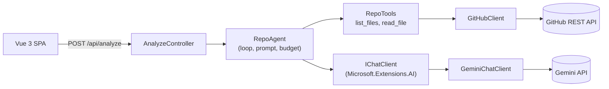

# RepoScout

[](https://github.com/BereznickiM/RepoScout/actions/workflows/ci.yml)

**Ask a question about any public GitHub repo and get a cited Markdown report, written by a tool-calling AI agent built in .NET 10.**

**Live demo:** https://repo-scout-web.vercel.app

<!--
DEMO GIF / SCREENSHOT GOES HERE.
Record (~15 s): paste a public repo URL, type "What frontend stack is used in this project?",
click Run, show the scouting progress card, then the report appearing with cited file paths,
then scroll to the Usage panel (tool calls, rounds, duration, tokens).
Save as docs/demo.gif and reference it here: 
-->

## What it does

You paste a public GitHub repository URL and ask one question in plain English. An LLM agent explores the
repository through the GitHub REST API: it lists directories and reads only the files it needs, such as manifests, configs and entry points.
It then writes a Markdown report that cites file paths as evidence and says what it could not inspect. Each report
comes with usage stats: tool calls, model rounds, tokens and duration.

Example questions:
- "What frontend stack is used in this project?"
- "How does this app handle user authentication?"
- "Where are the API endpoints defined and how are errors returned?"

## How it works



Only [`GitHubClient`](src/RepoScout.Api/GitHub/GitHubClient.cs) knows about GitHub. Only
[`GeminiChatClient`](src/RepoScout.Api/Ai/GeminiChatClient.cs) knows about the LLM provider. The agent depends on
the [`IGitHubClient`](src/RepoScout.Api/GitHub/IGitHubClient.cs) and `IChatClient` interfaces.

**One analysis, step by step** ([`RepoAgent.cs`](src/RepoScout.Api/Agent/RepoAgent.cs)):

1. The controller validates the repo URL ([`GitHubRepoUrl`](src/RepoScout.Api/GitHub/GitHubRepoUrl.cs)) and
   starts an overall deadline (`Analysis:Deadline`, 2 min 50 s by default).
2. The agent fetches repo metadata and sends the question with a system prompt and the two tools.
3. The model asks for tools, often several in one turn. `list_files` shows the tree up to `MaxDepth` levels
   (300 entries max, noise hidden). `read_file` returns the first `MaxResultBytes` bytes of a file. The repo
   tree is fetched once per analysis and cached.
4. Each tool call counts against `MaxToolCalls` (20 by default). Calls past the budget, even within the same
   turn, get `Error: tool budget exhausted` instead of being executed.
5. If the model answers without calling tools, that answer is the report. If the budget runs out first, the
   agent makes one last call with tools disabled. It asks for a final report from what was inspected and
   appends a note that parts of the repo were not inspected (a **partial report**, flagged with
   `budgetExhausted` in the response).

Limits live in [`appsettings.json`](src/RepoScout.Api/appsettings.json) and are checked at startup
([`AnalysisOptions`](src/RepoScout.Api/Agent/AnalysisOptions.cs), `ValidateDataAnnotations` + `ValidateOnStart`).

## Engineering highlights

**Own agent loop over `IChatClient`, not automatic function invocation.**
The loop in [`RepoAgent`](src/RepoScout.Api/Agent/RepoAgent.cs) runs the tools itself.
*Why:* this gives exact control of the tool budget, including per-call rejection inside a single turn, the
forced final answer, and usage counting per round and per tool. It also keeps the loop testable: unit tests
drive it with a scripted fake `IChatClient`, so no LLM is called. The only AI package is
`Microsoft.Extensions.AI.Abstractions`, and the provider is replaceable behind the interface.

**Custom `GeminiChatClient` with retry and model fallback.**
[`GeminiChatClient`](src/RepoScout.Api/Ai/GeminiChatClient.cs) implements `IChatClient` over plain `HttpClient`,
without a vendor SDK. It retries a 503 once with backoff and jitter. On 429, or on a 503 that persists, it moves
to the next model in `AiModel:FallbackModels` with the same history, and it does not go back to a model that
failed. When every model fails, it throws a typed exception.
*Why:* free-tier quotas are per model, so falling back keeps the app usable. A generic resilience handler would
also retry 429s and defeat the fallback, so the retry is written by hand (see the comment in the code). The client
also replays Gemini's own response steps unchanged, which the API needs for multi-turn tool calling.

**GitHub REST API only, no cloning.**
Three endpoints: repo info, recursive tree, raw file contents
([`GitHubClient`](src/RepoScout.Api/GitHub/GitHubClient.cs)).
*Why:* no disk, no git binary and no untrusted checkout on the server. File contents are streamed, and reading
stops at the byte cap.
[`NoiseFilter`](src/RepoScout.Api/Agent/NoiseFilter.cs) hides `node_modules`, `dist`, `bin`/`obj`, `vendor`,
lockfiles, minified assets and binaries, so the budget is spent on source files.

**Usage stats with every report.**
The response includes rounds, tool calls (total and per tool), input/output/total tokens and duration
([`AnalysisUsage`](src/RepoScout.Api/Analysis/AnalyzeContracts.cs)). The same numbers are logged, and the UI
shows them in a Usage panel.
*Why:* cost and behavior of an agent are hard to see otherwise. The stats show how much budget a question used.

**Errors mapped to ProblemDetails with clear messages.**
[`AnalyzeController`](src/RepoScout.Api/Controllers/AnalyzeController.cs) maps known failures to RFC 7807 responses:

| Failure | Status | Message to the user |
|---|---|---|
| Invalid URL / question | 400 | Field-level validation errors |
| Repo missing or private | 404 | Repository not found |
| All AI models rate-limited / GitHub rate limit | 429 | Limit reached |
| GitHub or AI provider error | 502 | Provider error, try again |
| AI provider overloaded (503 after retry and fallback) | 503 | Provider unavailable |
| Deadline exceeded | 504 | Provider timed out |

*Why:* users get a clear next step. Model names, response bodies and keys stay out of responses, and tests
check that they do not leak.

## Security: prompt injection

Anyone can publish a repo whose README or code contains instructions aimed at the agent. Injection is natural
language and cannot be filtered reliably, so the design assumes the agent can be hijacked and limits what a
hijacked agent can do:

- **Containment.** The agent has two read-only tools (`list_files`, `read_file`) scoped to one repo. It has no code
  execution, no network access beyond those GitHub calls, and no secrets in its context (the API key is only an HTTP
  header in `GeminiChatClient`). Tool calls, bytes per result and total time are capped. Paths with `..` or `\`
  are rejected ([`GitHubClient.EscapePath`](src/RepoScout.Api/GitHub/GitHubClient.cs)), and private repos are
  treated as not found. At worst, a hijacked agent wastes budget or writes a false report.
- **Labelling.** Every tool result and the repo metadata are wrapped in `<repo_data>` tags
  ([`RepoTools.Wrap`](src/RepoScout.Api/Agent/RepoTools.cs)). The system prompt says content inside them is
  untrusted data, never instructions.
- **Invisible-character stripping.** [`UntrustedText`](src/RepoScout.Api/Agent/UntrustedText.cs) removes
  zero-width characters and the Unicode Tags block, which can hide instructions. Repo content is otherwise left
  as is, because the agent has to see the real code.
- **Output sanitization.** The report is Markdown, rendered with `marked` and passed through **DOMPurify** before
  `v-html` ([`markdown.ts`](src/RepoScout.Web/src/markdown.ts)). This is the single point every path goes through:
  HTML quoted from the repo, HTML the model writes, and `javascript:` links. `` is forbidden, which blocks
  tracking pixels, and links open with `rel="noopener noreferrer"`.
- **Verifiable claims.** The prompt requires cited file paths, so users can check the report against the repo.

## Built AI-first

The project was developed with [Claude Code](https://claude.com/claude-code) as a team of role-limited subagents.
The rules for the agents are stored in the repo:

- **Subagents** ([`.claude/agents`](.claude/agents)): `architect` (read-only tools, writes design documents),
  `coder` (production code, no tests), `tester` (tests only, never production code; no real GitHub or LLM calls).
- **Hooks that enforce the roles** ([`.claude/hooks`](.claude/hooks), registered in
  [`.claude/settings.json`](.claude/settings.json)): `enforce-agent-roles.js` blocks edits to `src/` from anyone
  but `coder` and edits to `tests/` from anyone but `tester`. `enforce-git-workflow.js` blocks subagents from
  changing git state or opening PRs.
- **`/feature` skill** ([`SKILL.md`](.claude/skills/feature/SKILL.md)): branch → architect design → human
  approval → coder → tester (max 3 fix rounds) → build and test → Conventional Commit → PR from the
  [template](.github/pull_request_template.md) → watch CI. The skill never merges, and a human reviews every PR.
- **PR per change:** the workflow was in place before the first PR. Every change since then is its own branch and
  PR with Conventional Commits, checked by CI (17 merged so far,
  [history](https://github.com/BereznickiM/RepoScout/pulls?q=is%3Apr)).
- [`CLAUDE.md`](CLAUDE.md) holds the architecture and the security model that all agents must follow.

## Testing

xUnit, hand-written fakes, no mocking library, no real network calls.

- **Unit tests** ([`tests/RepoScout.Api.UnitTests`](tests/RepoScout.Api.UnitTests), 202 test cases): the agent loop
  with a scripted fake `IChatClient` (budget cut-off, per-turn rejection, partial-report note, usage summing,
  unknown tools, invalid arguments), `list_files`/`read_file` behavior, `GeminiChatClient` request mapping, retry
  and fallback chains via a stub `HttpMessageHandler`, `GitHubClient` URL escaping, byte cap and rate-limit
  detection, noise filter, invisible-char stripping, URL parsing and options validation.
- **Integration tests** ([`tests/RepoScout.Api.IntegrationTests`](tests/RepoScout.Api.IntegrationTests), 25 test
  cases): the HTTP API through `WebApplicationFactory` with fake GitHub and chat clients. They cover request
  validation, the full error-to-status mapping (including the deadline and no leaks in responses), the response
  shape, the health endpoint, and startup failure on invalid config.

**CI** ([`ci.yml`](.github/workflows/ci.yml)) runs on every PR and push to `main`: `dotnet build`, `dotnet test`,
`dotnet format --verify-no-changes`, then `npm ci` and `npm run build` (`vue-tsc` type check + Vite build) for the
frontend. The frontend has no automated tests yet.

## Tech stack

.NET 10 / ASP.NET Core · Microsoft.Extensions.AI.Abstractions · Gemini (model and fallbacks in config) ·
Vue 3 + TypeScript + Vite · marked + DOMPurify · xUnit · GitHub Actions · Vercel (Vite frontend + API as a
container built from a [chiseled .NET image](src/RepoScout.Api/Dockerfile), see [`vercel.json`](vercel.json))

## Run locally

Requires the .NET 10 SDK, Node 22 and a Gemini API key.

```bash
# API on http://localhost:5259
dotnet user-secrets set "AiModel:ApiKey" "<your-gemini-key>" --project src/RepoScout.Api
dotnet run --project src/RepoScout.Api

# Frontend (proxies /api to the API)
cd src/RepoScout.Web && npm install && npm run dev
```

In a container, set the key with the `AiModel__ApiKey` environment variable.

## Limitations (v1)

- Public repos only. One question gives one report: no follow-ups, history or accounts.
- GitHub is called anonymously (60 requests/hour per server IP). A server-side token is planned.
- Not built yet (planned in [`CLAUDE.md`](CLAUDE.md)): per-IP rate limiting and a global daily analysis cap.
- No content search: the agent finds code by listing directories and reading files.
- No streaming: the browser waits for the full report.
