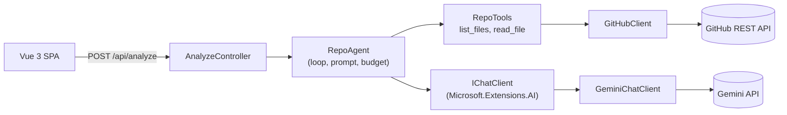

# RepoScout

**Ask anything about a public GitHub repo and get an evidence-backed answer. An AI agent explores the code through the GitHub API, decides what to inspect, and cites the files behind every claim. Agent loop with a provider-agnostic LLM layer, tool budgets and prompt-injection hardening.**

**Deployed at:** https://repo-scout-web.vercel.app

## What it does

You paste a public GitHub repository URL and ask a question. An LLM agent explores the
repository through the GitHub REST API, lists directories and reads only the files it needs.
It then writes a Markdown report that cites file paths as evidence.
Each report
comes with usage stats: tool calls, model rounds, tokens and duration.

Example questions:
- "What frontend stack is used in this project?"
- "How does this app handle user authentication?"
- "Where are the API endpoints defined and how are errors returned?"

## How it works

**Example analysis, step by step** ([`RepoAgent.cs`](src/RepoScout.Api/Agent/RepoAgent.cs)):

1. The controller validates the repo URL ([`GitHubRepoUrl`](src/RepoScout.Api/GitHub/GitHubRepoUrl.cs)) and starts an overall deadline.
2. The agent fetches repo metadata and sends the question with a system prompt and the two tools.
3. The model asks for tools, often several in one turn. `list_files` shows the tree up to `MaxDepth` levels. `read_file` returns the first `MaxResultBytes` bytes of a file. The repo tree is fetched once per analysis and cached.
4. Each tool call counts against `MaxToolCalls`. Calls past the budget, even within the same turn, get `Error: tool budget exhausted` instead of being executed.
5. If the model answers without calling tools, that answer is the report. If the budget runs out first, the agent makes one last call with tools disabled. It asks for a final report from what was inspected and appends a note that parts of the repo were not inspected (a **partial report**, flagged with `budgetExhausted` in the response).

## Engineering highlights

**Own agent loop over `IChatClient`, not automatic function invocation.**
The loop in [`RepoAgent`](src/RepoScout.Api/Agent/RepoAgent.cs) runs the tools itself.
This gives exact control of the tool budget, including per-call rejection inside a single turn, the forced final answer and usage counting per round and per tool. It also keeps the loop testable: unit tests drive it with a scripted fake `IChatClient`, so no LLM is called. The only AI package is
`Microsoft.Extensions.AI.Abstractions`, and the provider is replaceable behind the interface.

**GitHub API only, no cloning.**
Three endpoints: repo info, recursive tree, raw file contents
([`GitHubClient`](src/RepoScout.Api/GitHub/GitHubClient.cs)).
No disk, no git binary and no untrusted checkout on the server. File contents are streamed, and reading stops at the byte cap.
[`NoiseFilter`](src/RepoScout.Api/Agent/NoiseFilter.cs) hides `node_modules`, `dist`, `bin`/`obj`, `vendor`, lockfiles, minified assets and binaries, so the budget is spent on source files.

**Usage stats with every report.**
The response includes rounds, tool calls (total and per tool), input/output/total tokens and duration
([`AnalysisUsage`](src/RepoScout.Api/Analysis/AnalyzeContracts.cs)). The same numbers are logged, and the UI shows them in a Usage panel.
The stats show how much budget a question used.

## Security: prompt injection

Anyone can publish a repo whose README or code contains instructions aimed at the agent. Injection is natural language and cannot be filtered reliably, so the design assumes the agent can be hijacked and limits what a hijacked agent can do:

- **Containment.** The agent has two read-only tools (`list_files`, `read_file`) scoped to one repo. It has no code execution, no network access beyond those GitHub calls, and no secrets in its context. Tool calls, bytes per result and total time are capped. Paths with `..` or `\` are rejected ([`GitHubClient.EscapePath`](src/RepoScout.Api/GitHub/GitHubClient.cs)), and private repos are
  treated as not found. At worst, a hijacked agent wastes budget or writes a false report.
- **Labelling.** Every tool result and the repo metadata are wrapped in `<repo_data>` tags
  ([`RepoTools.Wrap`](src/RepoScout.Api/Agent/RepoTools.cs)). The system prompt says content inside them is untrusted data, never instructions.
- **Invisible-character stripping.** [`UntrustedText`](src/RepoScout.Api/Agent/UntrustedText.cs) removes zero-width characters and the Unicode Tags block, which can hide instructions. Repo content is otherwise left as is, because the agent has to see the real code.
- **Output sanitization.** The report is Markdown, rendered with `marked` and passed through **DOMPurify** before `v-html` ([`markdown.ts`](src/RepoScout.Web/src/markdown.ts)). `` is forbidden, which blocks tracking pixels, and links open with `rel="noopener noreferrer"`.

## Built AI-first

The project was developed with [Claude Code](https://claude.com/claude-code) as a team of role-limited subagents.
The rules for the agents are stored in the repo:

- **Subagents** ([`.claude/agents`](.claude/agents)):
`architect` (read-only tools, writes design documents)
`coder` (production code, no tests)
`tester` (tests only, never production code)
- **Hooks that enforce the roles** ([`.claude/hooks`](.claude/hooks), registered in
  [`.claude/settings.json`](.claude/settings.json)): `enforce-agent-roles.js` blocks edits to `src/` from anyone but `coder` and edits to `tests/` from anyone but `tester`.
  `enforce-git-workflow.js` blocks subagents from changing git state or opening PRs.
- **`/feature` skill** ([`SKILL.md`](.claude/skills/feature/SKILL.md)): branch → architect design → human
  approval → coder → tester (max 3 fix rounds) → build and test → Conventional Commit → PR from the
  [template](.github/pull_request_template.md) → watch CI. The skill never merges, and a human reviews every PR.

## Testing

- **Unit tests** ([`tests/RepoScout.Api.UnitTests`](tests/RepoScout.Api.UnitTests), 202 test cases):
the agent loop with a scripted fake `IChatClient`, `list_files`/`read_file` behavior, `GeminiChatClient` request mapping,
retry and fallback chains via a stub,
`GitHubClient` URL escaping,
byte cap and rate-limit detection,
noise filter and invisible-char stripping.
- **Integration tests** ([`tests/RepoScout.Api.IntegrationTests`](tests/RepoScout.Api.IntegrationTests), 25 test
  cases):
  API testing through `WebApplicationFactory` with fake GitHub and chat clients,
  request validation,
  the full error-to-status mapping and the response
  shape.

**CI** ([`ci.yml`](.github/workflows/ci.yml)) runs on every PR and push to `main`: `dotnet build`, `dotnet test`,
`dotnet format --verify-no-changes`, then `npm ci` and `npm run build` (`vue-tsc` type check + Vite build) for the frontend.

## Tech stack

- .NET 10 / ASP.NET Core · Microsoft.Extensions.AI.Abstractions
- Vue 3 + TypeScript + Vite
- Deployed to Vercel (Vite frontend + API as a
container built from a [chiseled .NET image](src/RepoScout.Api/Dockerfile), see [`vercel.json`](vercel.json))
